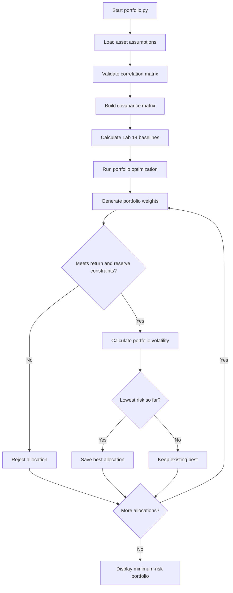

# Lab 15 — Portfolio Stability Decision

**Course:** FIN 43900 — Equity Research  
**Project:** Meridian Foundation Portfolio Analysis

## 1. Objective

The goal of this lab is to identify the minimum-risk portfolio that meets Meridian Foundation's 6.5% expected return objective and 3% reserve requirement. I also tested how changes in expected returns and correlations affect the optimal allocation.

## 2. Portfolio Optimization Results

I extended `portfolio.py` to evaluate portfolio allocations in 5% increments and select the feasible allocation with the lowest volatility.

| Asset | Optimal Weight |
|---|---:|
| Treasury bills | 0% |
| Treasury 10-year note | 20% |
| Investment-grade bond fund | 25% |
| Global equity index fund | 55% |

**Baseline results:**

- Expected return: 6.51%
- Portfolio volatility: 9.44%
- Reserve-eligible weight: 20.0%

The baseline portfolio meets the expected return objective and reserve requirement.

## 3. Portfolio.py Flowchart

The following flowchart summarizes the main steps of the portfolio analysis.

## 4. Sensitivity Analysis

### Scenario 1 — Lower Equity Return

I reduced the expected return on global equities from 8% to 7%, keeping the other assumptions unchanged.

| Metric | Original | Lower Equity Return |
|---|---:|---:|
| Expected return | 6.51% | 6.53% |
| Volatility | 9.44% | 12.94% |
| Treasury bills | 0% | 0% |
| Treasury 10-year note | 20% | 10% |
| Investment-grade bonds | 25% | 10% |
| Global equities | 55% | 80% |

The optimizer increased equity exposure to meet the return target despite the lower expected equity return. This increased portfolio risk substantially.

### Scenario 2 — Higher Bond–Equity Correlation

I increased the correlation between investment-grade bonds and global equities from 0.25 to 0.50.

| Metric | Original | Higher Correlation |
|---|---:|---:|
| Expected return | 6.51% | 6.52% |
| Volatility | 9.44% | 9.73% |
| Treasury bills | 0% | 0% |
| Treasury 10-year note | 20% | 40% |
| Investment-grade bonds | 25% | 0% |
| Global equities | 55% | 60% |

Higher correlation reduced diversification benefits and changed the optimal allocation.

## 5. Portfolio Stability Discussion

The sensitivity tests demonstrate that the optimal portfolio is sensitive to small changes in assumptions.

When equity expected returns decreased by one percentage point, the optimizer increased the equity allocation from 55% to 80%. When the bond–equity correlation increased, the investment-grade bond allocation decreased from 25% to 0%.

This suggests that the minimum-risk allocation is not necessarily stable across different market assumptions.

## 6. Partner Feedback

**Partner's observation:** [Add your partner's actual feedback here.]

**My response:** [Explain whether the feedback changed your interpretation or recommendation.]

## 7. Historical Fund Analysis

I downloaded 60 monthly adjusted closing prices for four ETFs from October 2021 through September 2026 using Yahoo Finance.

The selected funds were BIL (Treasury bills), IEF (Treasury bonds), LQD (investment-grade corporate bonds), and VT (global equities).

I calculated monthly returns and estimated annualized returns, volatilities, and correlations using the full historical sample and the most recent 36 monthly returns.

### Historical Return and Risk Estimates

| ETF | Five-Year Return | Five-Year Volatility | 36-Month Return | 36-Month Volatility |
|---|---:|---:|---:|---:|
| BIL | 3.66% | 0.49% | 4.37% | 0.21% |
| IEF | -1.73% | 7.72% | 3.07% | 6.66% |
| LQD | -0.93% | 9.87% | 4.84% | 7.82% |
| VT | 11.05% | 14.92% | 20.25% | 11.71% |

### Optimal Portfolio Comparison

| Metric | Five-Year Estimates | Most Recent 36 Months |
|---|---:|---:|
| BIL | 60% | 85% |
| IEF | 0% | 0% |
| LQD | 0% | 0% |
| VT | 40% | 15% |
| Expected Return | 6.61% | 6.75% |
| Volatility | 6.05% | 1.79% |
| Reserve Eligible | 60% | 85% |

### Interpretation

The historical estimates produce substantially different optimal portfolios depending on the observation period.

Using the full sample, the optimizer selects 60% Treasury bills and 40% global equities. Using the most recent 36 months, it selects 85% Treasury bills and 15% global equities.

The shorter estimation window produces higher estimated returns for Treasury bills and equities, allowing the portfolio to meet the 6.5% target with less equity exposure and lower estimated volatility.

This demonstrates that portfolio optimization is sensitive not only to assumed expected returns and correlations but also to the historical data window used to estimate those inputs.

The results are based on historical estimates rather than guaranteed future performance. The optimizer also evaluates portfolios in 5% allocation increments, so the selected portfolios are the lowest-risk feasible allocations on that grid, not necessarily the exact continuous optimum.

**Data source:** Yahoo Finance, downloaded October 22, 2026.  
**Sample:** October 2021–September 2026 (60 prices, 59 monthly returns).  
**Comparison window:** Most recent 36 monthly returns.

## 8. Partner Review and Feedback

**Reviewer:** Connor Guthrie

### Partner Feedback

The portfolio optimization model demonstrates how changes in expected returns, correlations, and historical estimation periods affect portfolio allocations.

The baseline portfolio allocates 20% to Treasury bonds, 25% to investment-grade bonds, and 55% to global equities, achieving a 6.51% expected return with 9.44% volatility.

One strength of the model is that it tests multiple scenarios instead of relying on a single set of assumptions. However, the historical analysis shows that the optimized allocation changes substantially depending on the estimation window.

**Question from reviewer:** How confident are you that the optimized portfolio will remain appropriate if market conditions change?

**My response:** I would not treat the optimized allocation as permanent. The results show that changes in return assumptions and historical estimation periods can significantly affect portfolio weights. I would regularly update the inputs and evaluate whether the portfolio continues to meet its objectives.

### Suggested Improvement

The reviewer recommended testing additional market scenarios and checking the optimized allocations against the complete investment mandate before making a final recommendation.

### Final Reflection

This review helped reinforce that portfolio optimization is a decision-support tool rather than a guarantee of future performance. The analysis should be combined with judgment, diversification considerations, and ongoing risk monitoring.